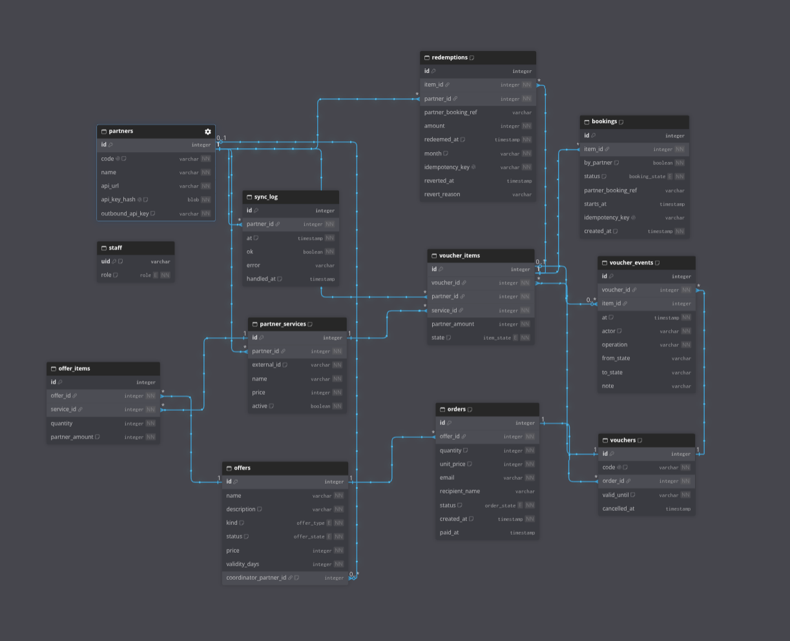

# System D: propozycja bazy danych i API (wersja uproszczona)

Propozycja na podstawie dokumentacji w repozytorium (reguły biznesowe, słownik pojęć, stany vouchera, `api-d.md`). Celem jest najprostsze rozwiązanie, które spełnia reguły i kryteria historyjek, a nie system produkcyjny.

## 1. Założenia upraszczające

- **Status vouchera nie jest zapisany w bazie.** Liczymy go z pozycji (POZ-05). Zmienia się tylko stan pozycji.
- **Płatność to status zamówienia.** Płatność jest symulowana, więc zamiast osobnej tabeli wystarczy `orders.status` (`pending` albo `paid`). Jeśli zamówienie jest już opłacone, ponowna płatność zwraca te same vouchery (ZAM-06).
- **Rozliczenie to zapytanie, a nie tabela.** Nie zamykamy okresów (ZAK-01), więc zestawienie to suma z tabeli `redemptions` za dany miesiąc.
- **Kolejka spraw to zapytanie, a nie tabela.** Pokazuje rezerwacje „do wyjaśnienia” i nieudane synchronizacje.
- **Ważność jako data.** `vouchers.valid_until` to ostatni dzień ważności (`RRRR-MM-DD`, strefa Europe/Warsaw). Voucher jest ważny, gdy dzisiejsza data w Warszawie nie jest późniejsza niż `valid_until`.
- **Idempotencja tylko tam, gdzie jest testowana.** Klucz `Idempotency-Key` zapisujemy w kolumnie `idempotency_key` tabel `redemptions` i `bookings` (REA-04, BLK-06). Zwolnienie blokady i anulowania powtórzone drugi raz dają 409, co niczego nie psuje.
- **Limit prób dostępu do vouchera** (KOD-08) trzymamy w pamięci serwera, bez tabeli.
- **Role operatora i administratora** zapisujemy w tabeli `staff` (uid z Firebase i rola).

## 2. Tabele



| Tabela | Co przechowuje | Reguły |
| :- | :- | :- |
| `partners` | A, B, C: adres API, skrót klucza partnera, klucz do wywołań partnera | SYN-01, UPR-01 |
| `partner_services` | Usługi pobrane od partnera, znacznik `active` | SYN-02, SYN-03 |
| `sync_log` | Każda synchronizacja: czas, sukces, błąd | SYN-04 |
| `offers` | Nazwa, opis, rodzaj, status, cena, ważność w dniach, koordynator pakietu | OFE-01 do OFE-05 |
| `offer_items` | Usługa, liczba sztuk, kwota dla partnera za sztukę | OFE-02 |
| `orders` | Oferta, liczba sztuk, cena z chwili zakupu, e-mail, imię obdarowanego, status | ZAM-01 do ZAM-06 |
| `vouchers` | Kod, zamówienie, termin ważności, data anulowania | KOD-01, KOD-02, WAZ-01 |
| `voucher_items` | Jedna sztuka usługi: partner, usługa, kwota dla partnera, stan | KOD-04, POZ-01 do POZ-03 |
| `bookings` | Rezerwacje i blokady, także nieudane | REZ-03, REZ-04, REZ-07, BLK-03 |
| `redemptions` | Wykorzystania z kwotą, miesiącem rozliczenia i znacznikiem cofnięcia | REA-02, REA-07, ROZ-02, ROZ-03 |
| `voucher_events` | Historia: kto, kiedy, operacja, stan przed i po | POZ-06 |
| `staff` | Konta panelu: uid z Firebase i rola | UPR-02, UPR-03 |

Pozycja oferty z liczbą 2 daje przy wydaniu dwie pozycje vouchera (KOD-04, P-12).

**Stany pozycji:** `available`, `booked`, `redeemed`, `expired`, `cancelled`, jak w `stany-vouchera-i-pozycji.md`.

**Statusy rezerwacji:** `confirmed` (potwierdzona), `uncertain` (do wyjaśnienia), `failed` (konflikt, brak miejsc albo błąd partnera), `ended` (zwolniona, anulowana albo usługa wykonana).

## 3. Czego pilnuje sama baza

| Ograniczenie | Reguła |
| :- | :- |
| `vouchers.code` jest UNIQUE | KOD-02 |
| Pozycja ma najwyżej jedno wykorzystanie z `reverted_at IS NULL` (częściowy indeks UNIQUE) | POZ-01, REA-05 |
| Pozycja ma najwyżej jedną rezerwację `confirmed` albo `uncertain` (częściowy indeks UNIQUE) | REZ-08 |

Dzięki drugiemu indeksowi z 20 równoległych realizacji tej samej pozycji przejdzie dokładnie jedna, nawet jeśli w kodzie będzie błąd. Każda operacja zmieniająca stan działa w jednej transakcji, a SQLite i tak wykonuje zapisy po kolei.

## 4. Status vouchera

```sql
SELECT CASE
  WHEN SUM(state = 'redeemed') = COUNT(*)                                         THEN 'used'
  WHEN SUM(state IN ('available','booked')) = 0 AND SUM(state = 'cancelled') > 0 THEN 'cancelled'
  WHEN SUM(state IN ('available','booked')) = 0 AND SUM(state = 'expired') > 0   THEN 'expired'
  WHEN SUM(state = 'redeemed') > 0                                                THEN 'partially_used'
  ELSE 'active'
END
FROM voucher_items WHERE voucher_id = ?;
```

Kolejność warunków jest taka sama jak w `stany-vouchera-i-pozycji.md`. Jeśli termin ważności minął, a zadanie nocne jeszcze nie oznaczyło pozycji, kod traktuje otwarte pozycje jak wygasłe (WAZ-03).

## 5. Operacje

| Operacja | Co się dzieje w bazie |
| :- | :- |
| Płatność | Zamówienie `paid`, powstaje `quantity` voucherów z pozycjami, wpisy w historii |
| Blokada (partner) | Wybieramy pierwszą pozycję `available` tej usługi, zmieniamy na `booked`, dodajemy rezerwację `confirmed` |
| Zwolnienie (partner) | Rezerwacja `ended`, pozycja `available` |
| Rezerwacja przez D | Wywołanie API partnera, potem rezerwacja `confirmed` i pozycja `booked`, albo `failed`, albo `uncertain` przy braku odpowiedzi |
| Realizacja (partner) | Nowy wiersz w `redemptions`, pozycja `redeemed`, rezerwacja `ended` |
| Cofnięcie realizacji (operator) | `reverted_at` i powód, pozycja `available` |
| Anulowanie vouchera (operator) | Otwarte pozycje `cancelled`, D anuluje ich rezerwacje u partnerów |
| Wygaszanie (raz na dobę) | Otwarte pozycje voucherów po terminie stają się `expired` |
| Wyjaśnianie (co kilka minut) | Rezerwacje `uncertain` są sprawdzane u partnera i zmieniają się na `confirmed` albo `failed` |

Każda zmiana stanu pozycji dodaje wiersz do `voucher_events`.

## 6. API

**Zasady wspólne:** błąd ma postać `{"error": {"code", "message", "request_id"}}`, czas w RFC 3339, kwoty w groszach, identyfikatory to liczby.

### 6.1 API dla partnerów (`/api/v1`)

Ścieżki zostają takie jak w `api-d.md`. Uwierzytelnianie: `Authorization: Bearer <klucz partnera>`.

| Metoda i ścieżka | Co robi | Błędy |
| :- | :- | :- |
| `GET /vouchers/{code}` | Weryfikacja: status, ważność, pozycje widoczne dla partnera | 404, 410 |
| `POST /vouchers/{code}/holds` | Blokada: `{service_id, partner_booking_ref}` | 403, 404, 409 `NO_AVAILABLE_ITEM`, 410 |
| `DELETE /vouchers/{code}/items/{item_id}/hold` | Zwolnienie blokady | 403, 409 `ITEM_NOT_BOOKED` |
| `POST /vouchers/{code}/items/{item_id}/redemption` | Realizacja: `{partner_booking_ref}` | 403, 404, 409 `ITEM_ALREADY_REDEEMED`, 410 |
| `GET /settlements?month=RRRR-MM` | Własne zestawienie | |

Partner widzi swoje pozycje, a koordynator pakietu (C) wszystkie pozycje pakietu (BLK-01). `service_id` w blokadzie to identyfikator usługi u partnera (`partner_services.external_id`).

Przykład odpowiedzi weryfikacji:

```json
{
  "code": "VD-7K3M-Q9TX-2HWP",
  "status": "partially_used",
  "valid_until": "2027-02-14",
  "items": [
    { "item_id": 101, "partner": "C", "service_id": "c-pobyt-2n", "service_name": "Pobyt 2 noce", "state": "booked" },
    { "item_id": 102, "partner": "A", "service_id": "a-masaz-relaks-60", "service_name": "Masaż relaksacyjny 60 min", "state": "available" }
  ]
}
```

### 6.2 API sklepu (`/api/shop`)

| Metoda i ścieżka | Co robi |
| :- | :- |
| `GET /offers?category=&partner=` | Katalog aktywnych ofert (OFE-09) |
| `GET /offers/{id}` | Szczegóły oferty |
| `POST /orders` | Zamówienie: `{offer_id, quantity, email, recipient_name}`, od 1 do 10 sztuk |
| `POST /orders/{id}/pay` | Symulowana płatność: `{"result": "success" \| "decline" \| "timeout"}`. Przy sukcesie zwraca kody voucherów |
| `GET /my_vouchers` | Vouchery zalogowanego klienta, czyli zamówienia na e-mail jego konta |
| `GET /vouchers/{code}?email=` | Strona vouchera dla niezalogowanego posiadacza (KOD-07, KOD-08) |
| `GET /vouchers/{code}/items/{item_id}/slots?email=&from=&to=` | Wolne terminy z API partnera, do 14 dni i tylko przed końcem ważności |
| `POST /vouchers/{code}/items/{item_id}/booking` | Rezerwacja: `{email, slot_id}` |

Wyniki rezerwacji: `201` potwierdzona, `409 SLOT_TAKEN` z listą wolnych terminów, `409 NO_CAPACITY`, `202` do wyjaśnienia, `503 PARTNER_UNAVAILABLE`. W każdym przypadku poza `201` pozycja zostaje `available` (REZ-05, REZ-09).

Kod i e-mail w adresie to uproszczenie. W prawdziwym systemie lepiej byłoby je wysyłać w treści żądania.

### 6.3 API panelu (`/api/admin`)

Wymaga tokenu Firebase i wpisu w tabeli `staff`. Trasy partnerów sprawdzają dodatkowo rolę `admin` (UPR-03).

| Obszar | Trasy |
| :- | :- |
| Partnerzy i usługi | `GET/POST /partners`, `POST /partners/{id}/sync`, `GET /services` |
| Oferty | `GET/POST /offers`, `PATCH /offers/{id}`, `POST /offers/{id}/publish`, `POST /offers/{id}/withdraw` |
| Vouchery | `GET /vouchers?q=` (kod albo e-mail), `GET /vouchers/{id}` (z historią), `POST /vouchers/{id}/cancel` |
| Rezerwacje i realizacje | `POST /bookings/{id}/cancel`, `POST /redemptions/{id}/revert` |
| Kolejka spraw | `GET /queue` |
| Rozliczenia | `GET /settlements?month=`, `GET /settlements/csv?month=` |

Pozycje oferty wysyłamy razem z ofertą w `POST /offers` i `PATCH /offers/{id}`, więc nie potrzebują osobnych tras. Publikacja sprawdza OFE-04: wszystkie usługi są aktywne, a suma kwot dla partnerów nie przekracza ceny.

### 6.4 Kody błędów

| HTTP | Kody |
| :- | :- |
| 401 | `UNAUTHENTICATED` |
| 403 | `FORBIDDEN`, `ITEM_NOT_OWNED`, `SERVICE_NOT_OWNED` |
| 404 | `VOUCHER_NOT_FOUND`, `NOT_FOUND` |
| 409 | `ITEM_ALREADY_REDEEMED`, `ITEM_NOT_BOOKED`, `NO_AVAILABLE_ITEM`, `SLOT_TAKEN`, `NO_CAPACITY`, `OFFER_NOT_ACTIVE` |
| 410 | `VOUCHER_EXPIRED`, `VOUCHER_CANCELLED` |
| 422 | `VALIDATION_FAILED` |
| 429 | `TOO_MANY_ATTEMPTS` |
| 503 | `PARTNER_UNAVAILABLE` |

## 7. Czego D potrzebuje od A, B, C

Propozycja do tabeli operacji w `kontrakt-integracji.md`:

| Operacja | Żądanie | Odpowiedź |
| :- | :- | :- |
| Lista usług | `GET /services` | `[{id, name, price, active}]` |
| Dostępność | `GET /services/{id}/slots?from=&to=` | `[{slot_id, starts_at, ends_at}]` |
| Rezerwacja | `POST /bookings {service_id, slot_id, voucher_code}` z `Idempotency-Key` | `{booking_ref}`, albo 409 przy konflikcie lub braku miejsc |
| Status rezerwacji | `GET /bookings?idempotency_key=` | `{booking_ref, status}` |
| Anulowanie | `DELETE /bookings/{booking_ref}` | 200 |

Status trzeba sprawdzać po kluczu idempotencji, bo przy przekroczeniu czasu D nie zna jeszcze `booking_ref`.

## 8. Pytania do zespołu

1. Czy w pakiecie z hotelem posiadacz może sam zarezerwować masaż i trening w sklepie, czy robi to tylko C (REZ-10)? Propozycja: tylko C, a sklep pokazuje te pozycje jako „planuje hotel”.
2. Jak liczyć przychód i marżę w raporcie (ROZ-04), skoro sprzedaż i realizacja mogą być w różnych miesiącach? Propozycja: przychód to opłacone zamówienia z danego miesiąca, a kwoty dla partnerów to realizacje z tego miesiąca.
3. „10 nieudanych prób z jednego adresu” (KOD-08): chodzi o adres IP czy e-mail? Propozycja: IP.
