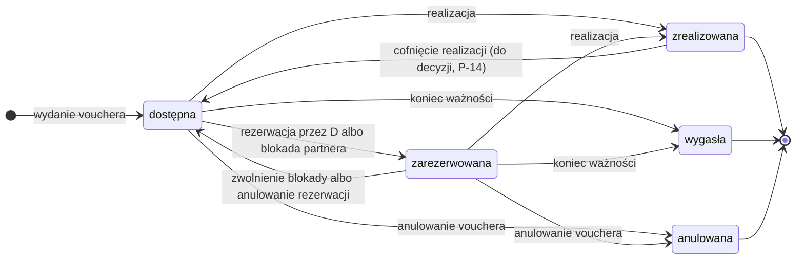
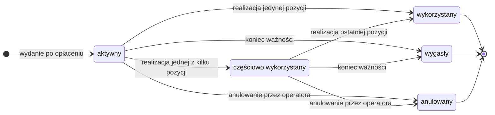

[← Wymagania](README.md)

# Stany vouchera i pozycji

> **Opiekun:** Maciej Rożek (AN) · **Ostatnia zmiana:** 2026-10-25 · **Issue:** D-02 Model pojęciowy danych i przypadki testowe, zadanie T2
>
> **Status:** szkic. Z tej strony korzystają przypadki testowe (D-02 T3 TM, D-02 T4 TA)

Stan zmienia się na poziomie **pozycji**. Status **vouchera** wynika z pozycji i nigdy nie jest ustawiany ręcznie (POZ-05). Numery reguł odsyłają do [reguł biznesowych](reguly-biznesowe.md).

Statusy zamówienia i płatności opisze specyfikacja D-13 T1, a statusy rezerwacji u partnera specyfikacja D-20 T1.

## Pozycja vouchera

| Stan | Kod w API (propozycja) | Znaczenie |
| :- | :- | :- |
| dostępna | `available` | Pozycję można zarezerwować, zablokować albo zrealizować |
| zarezerwowana | `booked` | Istnieje rezerwacja u partnera: złożona przez D albo zgłoszona przez partnera blokadą |
| zrealizowana | `redeemed` | Usługa wykonana, powstało wykorzystanie, pozycja wchodzi do rozliczenia |
| wygasła | `expired` | Termin ważności minął przed realizacją. Stan końcowy |
| anulowana | `cancelled` | Operator anulował voucher przed realizacją tej pozycji. Stan końcowy |

### Przejścia

| Z | Do | Zdarzenie | Kto | Warunki | Reguły |
| :- | :- | :- | :- | :- | :- |
| (brak) | dostępna | Wydanie vouchera | System, po udanej płatności | Zamówienie opłacone, voucher i pozycje w jednej transakcji | ZAM-05, KOD-04, KOD-05 |
| dostępna | zarezerwowana | Rezerwacja przez D | System D, po potwierdzeniu partnera | Termin przed końcem ważności, partner zwrócił identyfikator rezerwacji | REZ-02, REZ-03, WAZ-05 |
| dostępna | zarezerwowana | Blokada | Właściciel pozycji, przez API D | Voucher ważny, partner podał identyfikator swojej rezerwacji | BLK-03, BLK-07 |
| zarezerwowana | dostępna | Zwolnienie blokady | Właściciel pozycji, przez API D | Voucher ważny | BLK-05 |
| zarezerwowana | dostępna | Anulowanie rezerwacji | Operator, a D anuluje rezerwację w API partnera | Partner potwierdził anulowanie | REZ-12 |
| dostępna, zarezerwowana | zrealizowana | Realizacja | Właściciel pozycji, przez API D | Voucher ważny w chwili realizacji | REA-01, REA-02, WAZ-03 |
| zrealizowana | dostępna | Cofnięcie realizacji | Operator | Tylko jeśli zespół przyjmie P-14 | REA-07 |
| dostępna, zarezerwowana | wygasła | Koniec ważności | Zadanie cykliczne raz na dobę | Minęła 23:59:59 ostatniego dnia ważności (Europe/Warsaw) | WAZ-02, WAZ-04 |
| dostępna, zarezerwowana | anulowana | Anulowanie vouchera | Operator | Tylko jeśli zespół przyjmie P-13 | POZ-07 |

Konflikt terminu, brak miejsc i błąd partnera nie zmieniają stanu pozycji: zostaje dostępna (REZ-05, REZ-09). Gdy rezerwacja ma status „do wyjaśnienia”, pozycja też zostaje dostępna, ale do czasu wyjaśnienia nie da się jej zarezerwować ani zablokować drugi raz (REZ-08).

### Skutek operacji w każdym stanie

Tabela zakłada, że operację wykonuje właściciel pozycji, a voucher jest w terminie ważności. Inny partner dostaje 403 niezależnie od stanu (REA-03, BLK-07), a nieznany kod daje 404. To punkt wyjścia do przypadków testowych (D-02 T3).

| Operacja | dostępna | zarezerwowana | zrealizowana | wygasła | anulowana |
| :- | :- | :- | :- | :- | :- |
| Blokada | → zarezerwowana | 409 | 409 | 410 | 410 |
| Zwolnienie blokady | 409 | → dostępna | 409 | 410 | 410 |
| Rezerwacja przez D | → zarezerwowana, po potwierdzeniu partnera | 409 | 409 | 410 | 410 |
| Realizacja | → zrealizowana (201) | → zrealizowana (201) | 409, a z tym samym kluczem idempotencji 201 | 410 | 410 |

- Blokada wskazuje usługę, a nie pozycję. Jeśli voucher ma inną dostępną pozycję tej usługi, D zablokuje właśnie ją. Błąd 409 pojawia się dopiero wtedy, gdy wolnej pozycji nie ma (BLK-03, BLK-04).
- Kolumna „wygasła” dotyczy też pozycji, której zadanie cykliczne jeszcze nie oznaczyło, jeśli termin ważności już minął. Każda operacja sama sprawdza datę (WAZ-03).
- Kod 410 dla pozycji anulowanej przyjmujemy tak jak dla anulowanego vouchera w D-16.

## Voucher

### Jak wyliczamy status vouchera

„Otwarta” pozycja to pozycja dostępna albo zarezerwowana. Warunki sprawdzamy po kolei i obowiązuje pierwszy spełniony.

| Kolejność | Warunek | Status vouchera | Kod w API (propozycja) |
| :-: | :- | :- | :- |
| 1 | Wszystkie pozycje są zrealizowane | wykorzystany | `used` |
| 2 | Żadna pozycja nie jest otwarta i co najmniej jedna jest anulowana | anulowany | `cancelled` |
| 3 | Żadna pozycja nie jest otwarta i co najmniej jedna wygasła | wygasły | `expired` |
| 4 | Co najmniej jedna pozycja jest zrealizowana i co najmniej jedna otwarta | częściowo wykorzystany | `partially_used` |
| 5 | Żadna pozycja nie jest zrealizowana, a co najmniej jedna jest otwarta | aktywny | `active` |

Jeśli część pozycji zrealizowano, a reszta wygasła albo została anulowana, voucher jest **wygasły** albo **anulowany**. Zrealizowane pozycje nadal wchodzą do rozliczenia z partnerami (ROZ-02). Cofnięcie realizacji (P-14) wylicza status od nowa, więc voucher może wrócić na przykład z wykorzystanego do częściowo wykorzystanego.
