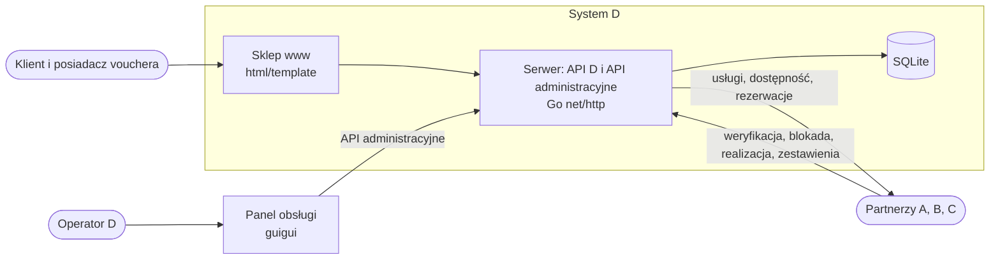

[← Dokumentacja](../README.md)

# Projekt rozwiązania

> **Opiekun:** Szymon Piechutowski (BE) · **Ostatnia zmiana:** 2026-10-25 · **Issue:** D-04 Specyfikacja API D, D-05 Schemat bazy danych i migracje, D-08 Szkielet serwera

Ten obszar opisuje, **jak** budujemy system D. To, **co** system ma robić, opisują [wymagania](../03-wymagania/README.md).

## Architektura

| Część | Technologia | Opis | Historyjki |
| :- | :- | :- | :- |
| Serwer | Go, `net/http` | API D dla partnerów, API administracyjne dla panelu, logika voucherów, zadania cykliczne | D-08, D-10 do D-22 |
| Baza danych | SQLite, migracje SQL w `migrations/` | Jeden schemat dla wszystkich modułów, klucze obce włączone, kwoty w groszach | D-05, D-06 |
| Sklep www | Szablony `html/template`, CSS wbudowany | Katalog, zamówienie, strona vouchera, wybór terminu. Samodzielne pliki bez zewnętrznych adresów, czytelne na telefonie | D-12, D-13, D-15, D-20 |
| Panel obsługi | guigui (aplikacja desktopowa) | Oferty, wyszukiwanie voucherów, historia, kolejka spraw, rozliczenia. Korzysta wyłącznie z API administracyjnego | D-23 |
| Klienci API partnerów | Interfejs `PartnerClient` w Go z adapterami A, B, C | Zmiana po stronie partnera dotyczy tylko jego adaptera ([ADR-007](../06-spotkania-i-decyzje/decyzje/ADR-007-zmiana-zakresu.md)) | D-10, D-20, D-21 |
| Symulator partnerów | `cmd/partnersim` | Udaje A, B i C według kontraktu, tryby `ok`, `conflict`, `full`, `down`, `slow` | D-09 |
| Dane przykładowe | `cmd/seed` | Partnerzy, usługi, oferty i vouchery w różnych stanach | D-06 |
| CI | GitHub Actions | `go vet` i `go test ./...` przy każdym PR | D-07 |

Strukturę katalogów repozytorium ustala D-07 T1.

## Strony

| Strona | Zawartość | Zadanie |
| :- | :- | :- |
| [model-danych.md](model-danych.md) | Model pojęciowy (encje i relacje) i schemat fizyczny SQLite | D-02 T1 (AN), D-05 (BE) |
| [api-d.md](api-d.md) | Opis API D dla partnerów: weryfikacja, blokada, realizacja, zestawienia | D-04 (AN), D-18 T6 (AN) |
| [kontrakt-integracji.md](kontrakt-integracji.md) | Uzgodnienia z A, B, C: formaty, błędy, operacje w API partnerów | D-03 (KP, AN) |
