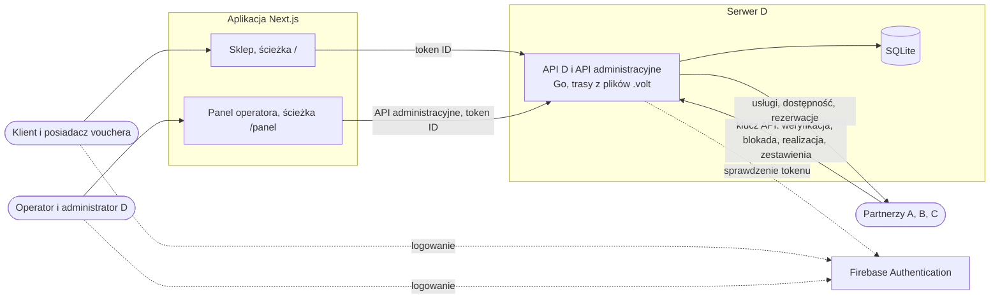

[← Dokumentacja](../README.md)

# Projekt rozwiązania

> **Opiekun:** Szymon Piechutowski (BE) · **Ostatnia zmiana:** 2026-10-25 · **Issue:** [D-04 (#85)](https://github.com/happy-voucher/happy-voucher-repo/issues/85), [D-05 (#86)](https://github.com/happy-voucher/happy-voucher-repo/issues/86), [D-08 (#88)](https://github.com/happy-voucher/happy-voucher-repo/issues/88), [D-26 (#90)](https://github.com/happy-voucher/happy-voucher-repo/issues/90)

Ten obszar opisuje, **jak** budujemy system D. To, **co** system ma robić, opisują [wymagania](../03-wymagania/README.md).

## Architektura

| Część | Technologia | Opis | Historyjki |
| :- | :- | :- | :- |
| Serwer | Go. Trasy API i schemat bazy deklarujemy w plikach `.volt`. `volt gen` generuje router, interfejsy kontrolerów, modele, zapytania i migracje, a `volt check` sprawdza deklaracje | API D dla partnerów, API administracyjne dla panelu, logika voucherów, zadania cykliczne. CORS dopuszcza adres aplikacji Next.js | D-05, D-08, D-10 do D-22 |
| Baza danych | SQLite, migracje generowane przez volt | Jeden schemat dla wszystkich modułów, klucze obce włączone, kwoty w groszach | D-05, D-06 |
| Aplikacja www | Next.js z Tailwind CSS, wspólny klient API D z obsługą błędów z kontraktu | Sklep (`/`): katalog renderowany po stronie serwera, zamówienie, strona vouchera, wybór terminu. Panel operatora (`/panel`): partnerzy, oferty, wyszukiwanie voucherów, historia, kolejka spraw, rozliczenia z eksportem CSV. Panel korzysta wyłącznie z API administracyjnego | D-12, D-13, D-15, D-20, D-23, D-26 |
| Logowanie | Firebase Authentication: e-mail i hasło albo konto Google | Aplikacja dołącza token ID do żądań do API D. Serwer odrzuca nieważny token (`401`), a do panelu wpuszcza tylko role `operator` i `admin` (`403` dla pozostałych) | D-08, D-23, D-26 |
| Klienci API partnerów | Interfejs `PartnerClient` w Go z adapterami A, B, C | Zmiana po stronie partnera dotyczy tylko jego adaptera ([ADR-007](../06-spotkania-i-decyzje/decyzje/ADR-007-zmiana-zakresu.md)) | D-10, D-20, D-21 |
| Symulator partnerów | `cmd/partnersim` | Udaje A, B i C według kontraktu, tryby `ok`, `conflict`, `full`, `down`, `slow`. Uruchamiany w CI przed testami integracyjnymi | D-09 |
| Dane przykładowe | `cmd/seed` | Partnerzy, usługi, oferty i vouchery w różnych stanach, używane w testach ręcznych i w Playwright | D-06 |
| CI | GitHub Actions | `volt check`, `go vet`, `go test ./...`, `npm run build` i `npm test` przy każdym PR | D-07 |
| Automatyzacja tablicy | GitHub Actions i aplikacja GitHub `happy-voucher-board-bot` | Workflow [Odblokuj zależne](../../.github/workflows/odblokuj-zalezne.yml): po zamknięciu issue przenosi odblokowane historyjki i ich zadania do „Gotowe do startu” | — |

Strukturę katalogów repozytorium ustala D-07 T1.

## Strony

| Strona | Zawartość | Zadanie |
| :- | :- | :- |
| [model-danych.md](model-danych.md) | Model pojęciowy (encje i relacje) i schemat fizyczny SQLite | D-02 T1 (AN), D-05 (BE) |
| [api-d.md](api-d.md) | Opis API D dla partnerów: weryfikacja, blokada, realizacja, zestawienia | D-04 (AN), D-18 T6 (AN) |
| [kontrakt-integracji.md](kontrakt-integracji.md) | Uzgodnienia z A, B, C: formaty, błędy, operacje w API partnerów | D-03 (KP, AN) |
