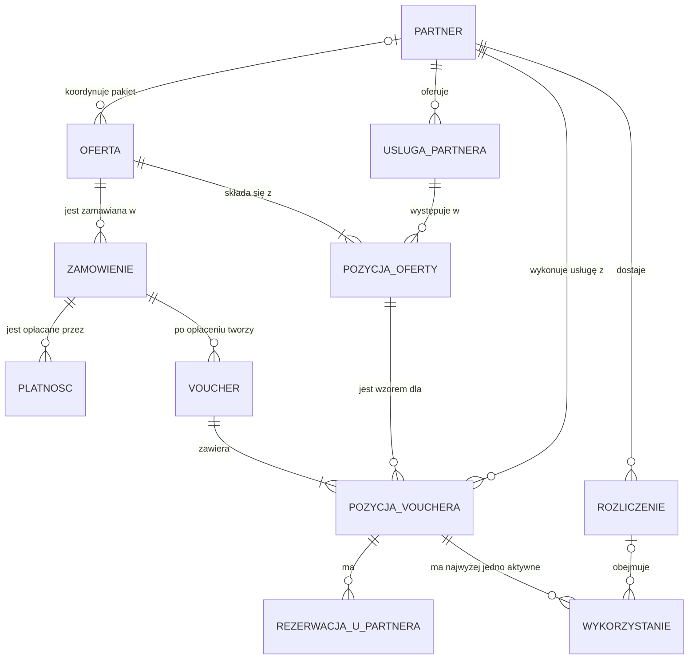
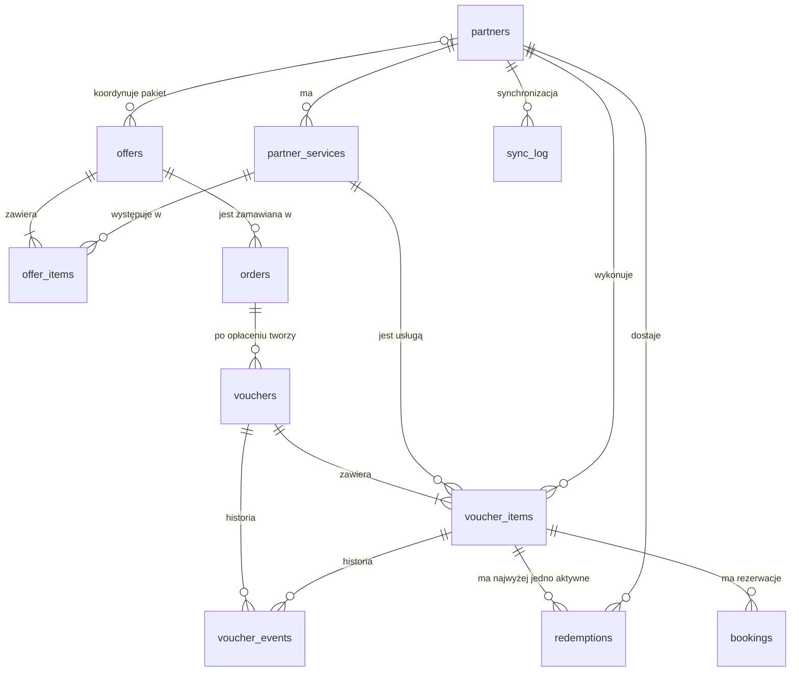

[← Projekt rozwiązania](README.md)

# Model danych

> **Opiekun:** Szymon Piechutowski (BE) · **Ostatnia zmiana:** 2026-11-22 · **Issue:** [D-02 (#83)](https://github.com/happy-voucher/happy-voucher-repo/issues/83) T1 model pojęciowy (AN), [D-05 (#86)](https://github.com/happy-voucher/happy-voucher-repo/issues/86) schemat bazy i migracje (BE) oraz [D-05/T6 (#131)](https://github.com/happy-voucher/happy-voucher-repo/issues/131) opis tabel (AN)
>
> **Status:** model pojęciowy oraz opis schematu fizycznego z `api/db/schema.volt`

Znaczenie pojęć opisuje [słownik pojęć](../03-wymagania/slownik-pojec.md), a stany pozycji i vouchera opisuje [stany-vouchera-i-pozycji.md](../03-wymagania/stany-vouchera-i-pozycji.md).

## Model pojęciowy

| Encja | Co przechowuje | Najważniejsze reguły |
| :- | :- | :- |
| Partner | A, B lub C: adres API, skrót klucza API | SYN-01, UPR-01 |
| Usługa partnera | Usługa pobrana z API partnera, znacznik aktywności | SYN-02, SYN-03 |
| Oferta | Nazwa, opis, cena, okres ważności w dniach, rodzaj, stan, opcjonalny koordynator pakietu | OFE-01 do OFE-05 |
| Pozycja oferty | Usługa partnera, liczba sztuk, kwota dla partnera | OFE-02, OFE-04 |
| Zamówienie | Oferta, liczba sztuk, e-mail, imię obdarowanego, cena z chwili zakupu | ZAM-01, ZAM-03 |
| Płatność | Próba płatności i jej wynik | ZAM-04 do ZAM-06 |
| Voucher | Kod, termin ważności, powiązanie z zamówieniem | KOD-01, KOD-02, WAZ-01 |
| Pozycja vouchera | Właściciel, kwota dla partnera, stan | KOD-04, POZ-01 do POZ-03 |
| Rezerwacja u partnera | Termin, identyfikator rezerwacji partnera, status (także „do wyjaśnienia”) | REZ-03, REZ-07 |
| Wykorzystanie | Data realizacji, identyfikator rezerwacji partnera, znacznik cofnięcia | REA-02, POZ-01 |
| Rozliczenie | Partner, miesiąc, suma kwot | ROZ-02 do ROZ-05 |

## Schemat fizyczny

Schemat deklarujemy w plikach `.volt`. `volt check` sprawdza deklaracje, a `volt gen` generuje z nich modele, zapytania i migracje dla SQLite.

Schemat fizyczny jest zadeklarowany w [`api/db/schema.volt`](../../api/db/schema.volt); pełne uzasadnienie i założenia upraszczające są w [`api/propozycja-api-i-bazy.md`](../../api/propozycja-api-i-bazy.md).

**Jak model pojęciowy przekłada się na tabele.** Większość encji ma własną tabelę. Trzy świadomie jej nie mają:

- **Płatność** nie ma tabeli: płatność jest symulowana, więc jej wynik to `orders.status` (`pending` albo `paid`) i `orders.paid_at`. Ponowna płatność nie tworzy drugiego kompletu voucherów (ZAM-06).
- **Rozliczenie** nie ma tabeli: to zapytanie po `redemptions` za dany miesiąc (indeks `(partner_id, month)`), bo nie zamykamy okresów rozliczeniowych (ZAK-01).
- **Status vouchera** nie jest kolumną: wyliczamy go ze stanów pozycji (POZ-05). Limit prób dostępu do vouchera (KOD-08) trzymamy w pamięci serwera, też bez tabeli.

### Diagram tabel

### Tabele

Wszystkie kwoty są liczbami całkowitymi w groszach (ROZ-01), a klucze obce są włączone. Czas zapisujemy w UTC, natomiast `valid_until` i `month` to daty w strefie Europe/Warsaw.

| Tabela | Kolumny | Klucze, indeksy i ograniczenia | Reguły |
| :- | :- | :- | :- |
| `partners` | id, code, name, api_url, api_key_hash, outbound_api_key | PK id; UNIQUE code; UNIQUE api_key_hash (skrót SHA-256 klucza partnera) | SYN-01, UPR-01 |
| `partner_services` | id, partner_id, external_id, name, price, active | PK id; FK partner_id; UNIQUE (partner_id, external_id); active domyślnie true, usług nie usuwamy | SYN-02, SYN-03 |
| `sync_log` | id, partner_id, at, ok, error, handled_at | PK id; FK partner_id; wpis z błędem i bez handled_at to sprawa w kolejce | SYN-04 |
| `offers` | id, name, description, kind, status, price, validity_days, coordinator_partner_id | PK id; FK coordinator_partner_id (null); kind i status z listy dozwolonych; status domyślnie draft | OFE-01 do OFE-05 |
| `offer_items` | id, offer_id, service_id, quantity, partner_amount | PK id; FK offer_id, service_id | OFE-02 |
| `orders` | id, offer_id, quantity, unit_price, email, recipient_name, status, created_at, paid_at | PK id; FK offer_id; indeks email; status z listy dozwolonych; cena z chwili zakupu w unit_price | ZAM-01 do ZAM-06 |
| `vouchers` | id, code, order_id, valid_until, cancelled_at | PK id; UNIQUE code (KOD-02); FK order_id; status nie jest zapisany | KOD-01, KOD-02, WAZ-01, POZ-05 |
| `voucher_items` | id, voucher_id, partner_id, service_id, partner_amount, state | PK id; FK voucher_id, partner_id, service_id; stan z listy dozwolonych, domyślnie available; właściciel i kwota kopiowane przy wydaniu | KOD-04, POZ-01 do POZ-03, OFE-07 |
| `bookings` | id, item_id, by_partner, status, partner_booking_ref, starts_at, idempotency_key, created_at | PK id; FK item_id; UNIQUE idempotency_key; **częściowy UNIQUE** na item_id, gdy status to confirmed albo uncertain (jedna żywa rezerwacja); nieudane próby też zapisane | REZ-03, REZ-04, REZ-08, BLK-03, BLK-06 |
| `redemptions` | id, item_id, partner_id, partner_booking_ref, amount, redeemed_at, month, idempotency_key, reverted_at, revert_reason | PK id; FK item_id, partner_id; UNIQUE idempotency_key; **częściowy UNIQUE** na item_id, gdy reverted_at jest puste (najwyżej jedno aktywne wykorzystanie); indeks (partner_id, month) dla rozliczeń | REA-02, REA-04, REA-05, POZ-01, ROZ-02, ROZ-03 |
| `voucher_events` | id, voucher_id, item_id, at, actor, operation, from_state, to_state, note | PK id; FK voucher_id, item_id (null); indeks (voucher_id, at); actor np. partner:A, operator:&lt;uid&gt;, system | POZ-06 |
| `staff` | uid, role | PK uid (UID z Firebase); rola operator albo admin; konto bez wiersza dostaje 403 | UPR-02 |

Dwa częściowe indeksy UNIQUE (`bookings` i `redemptions`) są kluczowe: wymuszają jednorazowość pozycji (POZ-01, REA-05) i jedną żywą rezerwację (REZ-08) na poziomie bazy, niezależnie od kodu.

Schemat musi spełniać kryteria D-05:
- schemat w plikach `.volt` odwzorowuje model pojęciowy z D-02, a `volt check` przechodzi,
- kod vouchera ma ograniczenie UNIQUE,
- pozycja vouchera nie może mieć dwóch aktywnych wykorzystań,
- klucze obce są włączone, a kwoty są liczbami całkowitymi w groszach,
- migracje uruchamiają się przy starcie serwera na pustej bazie i na bazie z danymi.
