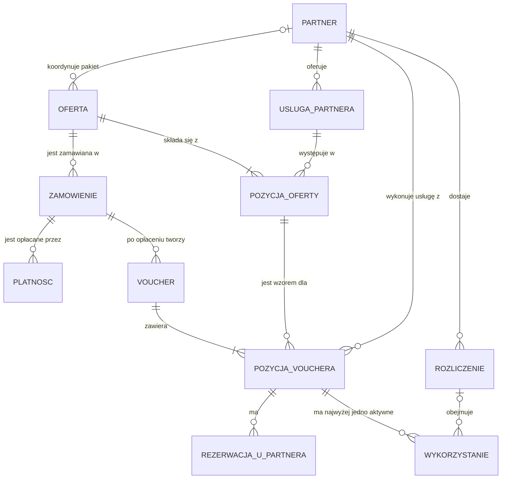

[← Projekt rozwiązania](README.md)

# Model danych

> **Opiekun:** Szymon Piechutowski (BE) · **Ostatnia zmiana:** 2026-10-25 · **Issue:** D-02 T1 model pojęciowy (AN), D-05 schemat bazy i migracje (BE), D-05 T5 opis tabel (AN)
>
> **Status:** szkic modelu pojęciowego. Schemat fizyczny powstanie w D-05

Znaczenie pojęć opisuje [słownik pojęć](../03-wymagania/slownik-pojec.md), a stany pozycji i vouchera opisuje [stany-vouchera-i-pozycji.md](../03-wymagania/stany-vouchera-i-pozycji.md).

## Model pojęciowy

| Encja | Co przechowuje | Najważniejsze reguły |
| :- | :- | :- |
| Partner | A, B lub C: adres API, skrót klucza API | SYN-01, UPR-01 |
| Usługa partnera | Usługa pobrana z API partnera, znacznik aktywności | SYN-02, SYN-03 |
| Oferta | Nazwa, opis, cena, okres ważności w dniach, rodzaj, stan, opcjonalny koordynator pakietu | OFE-01 do OFE-05 |
| Pozycja oferty | Usługa partnera, liczba sztuk, kwota dla partnera | OFE-02, OFE-04 |
| Zamówienie | Oferta, liczba sztuk, e-mail, imię obdarowanego, cena z chwili zakupu | ZAM-01, ZAM-03 |
| Płatność | Próba płatności i jej wynik | ZAM-04 do ZAM-06 |
| Voucher | Kod, termin ważności, powiązanie z zamówieniem | KOD-01, KOD-02, WAZ-01 |
| Pozycja vouchera | Właściciel, kwota dla partnera, stan | KOD-04, POZ-01 do POZ-03 |
| Rezerwacja u partnera | Termin, identyfikator rezerwacji partnera, status (także „do wyjaśnienia”) | REZ-03, REZ-07 |
| Wykorzystanie | Data realizacji, identyfikator rezerwacji partnera, znacznik cofnięcia | REA-02, POZ-01 |
| Rozliczenie | Partner, miesiąc, suma kwot | ROZ-02 do ROZ-05 |

## Schemat fizyczny

[uzupełnia BE w D-05: tabele, klucze, indeksy i ograniczenia, opis tabela po tabeli i diagram]

Schemat musi spełniać kryteria D-05:
- kod vouchera ma ograniczenie UNIQUE,
- pozycja vouchera nie może mieć dwóch aktywnych wykorzystań (częściowy indeks UNIQUE),
- klucze obce są włączone, a kwoty są liczbami całkowitymi w groszach,
- migracje uruchamiają się na pustej bazie przy starcie serwera i są idempotentne.
