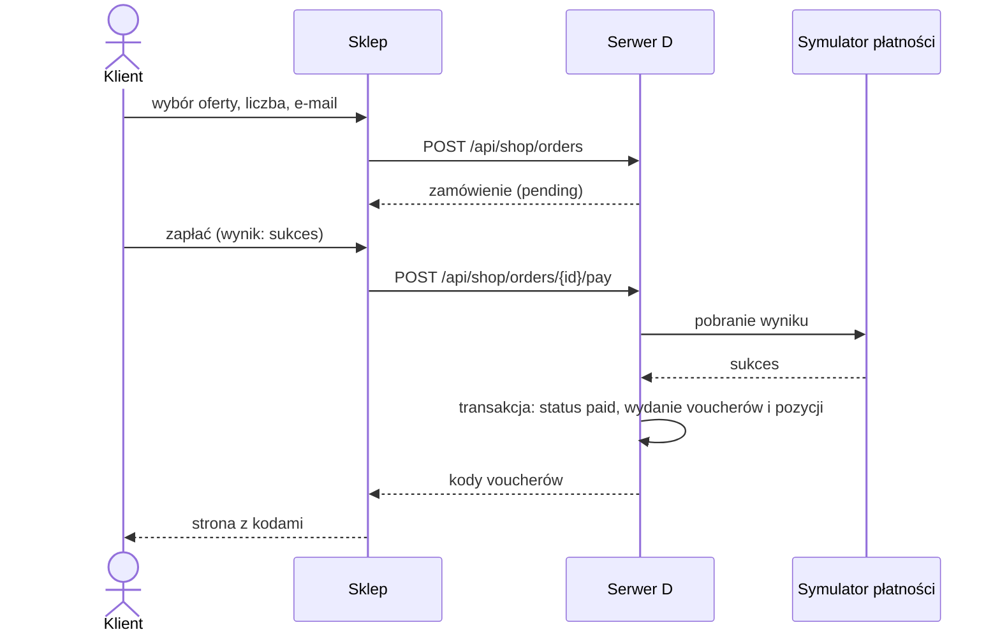

[← Projekt rozwiązania](README.md)

# Przebieg zakupu i płatności

> **Opiekun:** Szymon Piechutowski (BE) · **Autor:** Maciej Rożek (AN) · **Ostatnia zmiana:** 2026-11-23 · **Issue:** [D-13/T1 Przebieg zakupu i przypadki brzegowe (#170)](https://github.com/happy-voucher/happy-voucher-repo/issues/170)
>
> **Status:** szkic do przeglądu przez BE. Doprecyzowuje ZAM-05 (przebieg po przekroczeniu czasu i ponowienie płatności).

Strona opisuje drogę od katalogu do wydania voucherów oraz zachowanie w sytuacjach błędnych. Reguły to [ZAM](../03-wymagania/reguly-biznesowe.md#zam-zamówienia-i-płatność) i [KOD](../03-wymagania/reguly-biznesowe.md#kod-voucher-i-kod). Strony sklepu opisuje [uklad-stron.md](uklad-stron.md), a model danych [model-danych.md](model-danych.md). Płatność jest symulowana (ZAM-04).

## Przebieg poprawny

1. Klient wybiera aktywną ofertę w katalogu i przechodzi do zamówienia (ZAM-02).
2. Podaje liczbę sztuk (1–10), e-mail i opcjonalnie imię obdarowanego. Cena z chwili zakupu jest zapamiętana w zamówieniu (ZAM-01, ZAM-03, OFE-07). Zamówienie powstaje ze statusem `pending`.
3. Klient wybiera wynik symulowanej płatności: sukces, odmowa albo przekroczenie czasu (ZAM-04).
4. Przy sukcesie w jednej transakcji: zamówienie dostaje status `paid` i `paid_at`, powstaje tyle voucherów, ile sztuk, a z każdej pozycji oferty tyle pozycji vouchera, ile sztuk usługi, każda w stanie `available` (ZAM-05, ZAM-07, KOD-04, KOD-05).
5. Klient widzi kody voucherów z linkami do ich stron (KOD-06).

## Stany zamówienia

| Stan | Znaczenie | Przejście |
| :- | :- | :- |
| `pending` | Zamówienie złożone, niezapłacone | po udanej płatności → `paid` |
| `paid` | Zapłacone, vouchery wydane | stan końcowy |

Statusu zapłaconego zamówienia nie cofamy, a zwrotów nie ma (ZAK-01).

## Przypadki brzegowe

| Sytuacja | Zachowanie | Reguła |
| :- | :- | :- |
| **Odmowa płatności** | Nic nie powstaje: zamówienie zostaje `pending`, voucherów brak. Klient może ponowić płatność tego samego zamówienia. | ZAM-05 |
| **Przekroczenie czasu** | Wynik niepewny. Zamówienie zostaje `pending`, a klient widzi komunikat „nie wiemy, czy płatność przeszła — spróbuj ponownie”. Ponowienie jest bezpieczne dzięki regule niżej. *(propozycja AN doprecyzowująca ZAM-05)* | ZAM-05, ZAM-06 |
| **Ponowienie płatności** | Wydanie voucherów jest powiązane ze zmianą statusu `pending`→`paid` w jednej transakcji. Jeśli zamówienie jest już `paid`, ponowienie nie tworzy drugiego kompletu voucherów i zwraca te same kody (idempotentnie). | ZAM-06 |
| **Oferta wycofana lub zmieniona w trakcie** | Zamówić można tylko ofertę aktywną. Po złożeniu zamówienia zmiana ceny lub składu oferty nie dotyczy tego zamówienia — liczy się cena i skład z chwili zakupu. | ZAM-02, OFE-07 |
| **Partner nie odpowiada** | Sprzedaż i wydanie voucherów działają niezależnie od dostępności partnerów; rezerwacja terminu to późniejszy, osobny krok. | ZAM-08 |

## Wydanie voucherów

- Voucher i wszystkie jego pozycje powstają w jednej transakcji (KOD-05).
- Każda sztuka w zamówieniu to osobny voucher z własnym, unikalnym kodem (ZAM-07, KOD-01, KOD-02).
- Termin ważności liczymy z okresu ważności oferty od dnia opłacenia (WAZ-01).
- Właściciel pozycji i kwota dla partnera są kopiowane z oferty przy wydaniu (POZ-02, OFE-07).

## Powiązania

- Strony: `/zamowienie/[ofertaId]`, `/zamowienie/[id]/platnosc`, `/zamowienie/[id]/potwierdzenie` (opis w [uklad-stron.md](uklad-stron.md)).
- Endpointy: `POST /api/shop/orders` i `POST /api/shop/orders/{id}/pay` (propozycja w [api/propozycja-api-i-bazy.md](../../api/propozycja-api-i-bazy.md)).
- Tabele: `orders`, `vouchers`, `voucher_items` ([model-danych.md](model-danych.md)).
