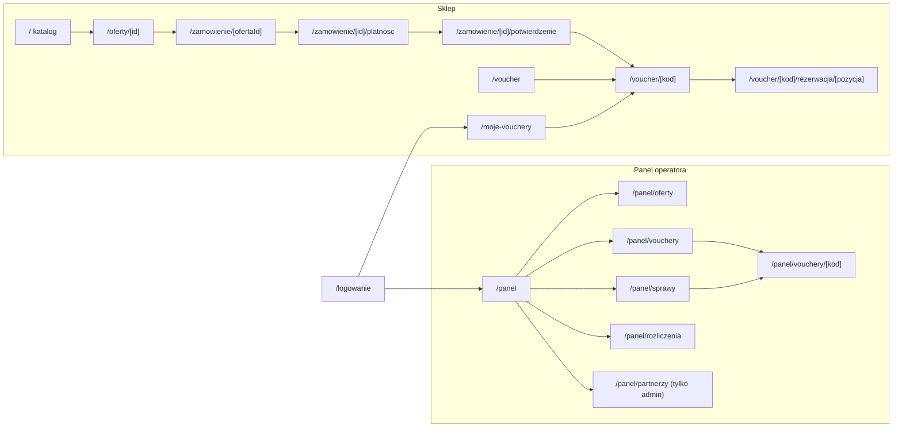

[← Projekt rozwiązania](README.md)

# Układ stron i ekrany

> **Opiekun:** Szymon Piechutowski (BE) · **Autor:** Maciej Rożek (AN) · **Ostatnia zmiana:** 2026-10-25 · **Issue:** [D-26/T1 układ stron i nawigacji (#148)](https://github.com/happy-voucher/happy-voucher-repo/issues/148), [D-23/T1 lista ekranów i pól panelu (#216)](https://github.com/happy-voucher/happy-voucher-repo/issues/216)
>
> **Status:** szkic do przeglądu przez FE (Krystian Inoch). Ścieżki są propozycją dla aplikacji Next.js z D-26

Strona opisuje, jakie strony ma sklep i panel operatora, kto na nie wchodzi i co na nich jest. Jedna aplikacja Next.js z Tailwind CSS obsługuje sklep pod `/` i panel pod `/panel` (D-26). Logowanie idzie przez Firebase. Wszystkie dane pochodzą z API D, a panel korzysta wyłącznie z API administracyjnego (UPR-02, UPR-03).

## Mapa stron

## Nawigacja i dostęp

| Część | Menu | Kto ma dostęp |
| :- | :- | :- |
| Sklep | Katalog, Mój voucher, Moje vouchery (po zalogowaniu), Zaloguj / Wyloguj | Każdy. „Moje vouchery” tylko po zalogowaniu |
| Panel | Start, Oferty, Vouchery, Sprawy, Rozliczenia, Partnerzy | Konta z rolą `operator` albo `admin`. Pozycja „Partnerzy” tylko dla `admin` |

- Niezalogowany użytkownik, który wejdzie na `/panel` albo `/moje-vouchery`, trafia na `/logowanie` i po zalogowaniu wraca na stronę, z której przyszedł.
- Zalogowane konto bez roli, które wejdzie na `/panel`, widzi stronę `403` (D-26).
- Strony są czytelne na telefonie (D-12) i używają systemowych czcionek bezszeryfowych (D-26).
- Każda strona pokazuje błąd API zrozumiałym komunikatem, bez kodu błędu. Treść komunikatów ustala D-21/T1.

## Sklep

| Ścieżka | Strona | Co pokazuje i co można zrobić | Historyjka | Reguły |
| :- | :- | :- | :- | :- |
| `/` | Katalog | Aktywne oferty z ceną, terminem ważności i partnerami. Filtry: partner (A, B, C) i rodzaj (masaż, fitness, hotel, pakiety). Renderowany po stronie serwera | D-12 | OFE-03, OFE-09 |
| `/oferty/[id]` | Szczegóły oferty | Opis, cena, okres ważności, każda usługa z oferty z nazwą partnera. Przycisk „Kup” | D-12 | OFE-09 |
| `/zamowienie/[ofertaId]` | Zamówienie | Liczba sztuk (1–10), e-mail, opcjonalnie imię obdarowanego, cena do zapłaty | D-13 | ZAM-01, ZAM-03 |
| `/zamowienie/[id]/platnosc` | Płatność testowa | Wybór wyniku symulowanej płatności: sukces, odmowa, przekroczenie czasu. Po odmowie można spróbować ponownie | D-13 | ZAM-04, ZAM-05 |
| `/zamowienie/[id]/potwierdzenie` | Potwierdzenie zakupu | Kody voucherów (po jednym na sztukę) z linkami do stron voucherów | D-15 | KOD-06, ZAM-07 |
| `/voucher` | Mój voucher | Formularz: kod i e-mail z zamówienia. Błędny e-mail daje ten sam komunikat co nieznany kod. Po 10 nieudanych próbach blokada na 15 minut | D-15 | KOD-07, KOD-08 |
| `/voucher/[kod]` | Strona vouchera | Status, termin ważności, każda pozycja z usługą, partnerem, stanem i terminem rezerwacji. Przy dostępnej pozycji przycisk „Zarezerwuj termin” | D-15, D-20 | KOD-07, REA-06 |
| `/voucher/[kod]/rezerwacja/[pozycja]` | Wybór terminu | Wolne terminy z API partnera (do 14 dni, tylko przed końcem ważności), wybór i potwierdzenie. Przy konflikcie najbliższe wolne terminy, przy braku miejsc propozycja innego zakresu dat | D-20, D-21 | REZ-01, REZ-05, WAZ-05 |
| `/moje-vouchery` | Moje vouchery | Lista voucherów zalogowanego klienta: kod, oferta, status, termin ważności | D-15 | KOD-07 |
| `/logowanie` | Logowanie | E-mail i hasło albo konto Google (Firebase) | D-26 | UPR-02 |

Pakiet z noclegiem: na stronie vouchera pozycja pobytu w C ma przycisk „Zarezerwuj pobyt”. Masaż i trening w pakiecie rezerwuje hotel C, więc te pozycje pokazują tylko stan i termin (REZ-10).

## Panel operatora: ekrany i pola

### Start (`/panel`)

| Pole | Opis |
| :- | :- |
| Sprawy do wyjaśnienia | Liczba spraw w kolejce, z podziałem na rezerwacje „do wyjaśnienia” i nieudane synchronizacje. Link do `/panel/sprawy` |
| Ostatnie synchronizacje | Dla każdego partnera czas i wynik ostatniej synchronizacji |

### Oferty (`/panel/oferty`, `/panel/oferty/nowa`, `/panel/oferty/[id]`) · D-11

**Lista ofert:** nazwa, rodzaj (usługa albo pakiet), cena, okres ważności w dniach, stan (robocza, aktywna, wycofana), liczba sprzedanych voucherów. Filtry: stan i rodzaj.

**Formularz oferty:**

| Pole | Opis | Reguła |
| :- | :- | :- |
| Nazwa, opis | Tekst widoczny w katalogu | OFE-01 |
| Cena | W złotych w formularzu, zapisywana w groszach | OFE-01, ROZ-01 |
| Okres ważności | Liczba dni | WAZ-01 |
| Rodzaj | Voucher na usługę albo pakiet | OFE-01 |
| Pozycje oferty | Dla każdej: usługa partnera (wybór z aktywnych usług), liczba sztuk, kwota dla partnera za sztukę | OFE-02 |
| Koordynator pakietu | Ustawiany automatycznie na C, gdy pakiet zawiera pobyt | OFE-05 |
| Podsumowanie | Suma kwot dla partnerów i marża D, wyliczane na bieżąco | OFE-04 |

Przyciski: „Zapisz roboczą”, „Opublikuj”, „Wycofaj”. „Opublikuj” jest zablokowany z komunikatem, gdy któraś usługa jest nieaktywna albo suma kwot przekracza cenę (OFE-04).

### Vouchery (`/panel/vouchery`) · D-23

**Wyszukiwanie:** jedno pole na kod vouchera, e-mail klienta albo numer zamówienia.

**Wyniki:** kod, oferta, status, termin ważności, e-mail klienta, data zakupu.

### Voucher i historia (`/panel/vouchery/[kod]`) · D-23

| Sekcja | Pola |
| :- | :- |
| Dane vouchera | Kod, status, termin ważności, numer zamówienia, e-mail klienta, imię obdarowanego, data zakupu |
| Pozycje | Usługa, partner, stan, termin rezerwacji, identyfikator rezerwacji partnera, data realizacji, kwota dla partnera |
| Historia | Czas, kto (partner, UID operatora albo system), stan przed i po, operacja (POZ-06) |

Akcje operatora (tylko jeśli zespół przyjmie propozycje P-13, P-14 i P-15 z [reguł](../03-wymagania/reguly-biznesowe.md#otwarte-pytania)): „Anuluj rezerwację”, „Anuluj voucher”, „Cofnij realizację”. Każda wymaga podania powodu i trafia do historii z UID operatora.

### Sprawy do wyjaśnienia (`/panel/sprawy`) · D-21, D-23

| Pole | Opis |
| :- | :- |
| Rodzaj | Rezerwacja „do wyjaśnienia” albo nieudana synchronizacja |
| Od kiedy | Czas powstania sprawy |
| Partner | A, B albo C |
| Voucher i pozycja | Kod i usługa (dla rezerwacji), z linkiem do strony vouchera |
| Ostatni błąd | Kod i komunikat błędu partnera albo „brak odpowiedzi” |
| Liczba prób | Ile razy system już sprawdzał sprawę |

Przyciski: „Sprawdź teraz” (zapytanie do partnera) i „Oznacz jako wyjaśnione” z wyborem wyniku: rezerwacja potwierdzona albo brak rezerwacji (REZ-07).

### Rozliczenia (`/panel/rozliczenia`) · D-22

**Wybór:** partner i miesiąc.

**Tabela:** kod vouchera, usługa, data realizacji, identyfikator rezerwacji partnera, kwota (ROZ-04).

**Sumy:** przychód, suma kwot dla partnera, marża D. Przycisk „Eksport CSV”. Suma w CSV jest równa sumie w API partnera (ROZ-05).

### Partnerzy (`/panel/partnerzy`, `/panel/partnerzy/[id]`) · D-10, D-23, tylko `admin`

| Sekcja | Pola |
| :- | :- |
| Lista | Identyfikator (A, B, C), nazwa, adres API, czas i wynik ostatniej synchronizacji, liczba aktywnych usług. Przycisk „Synchronizuj teraz” |
| Dane partnera | Nazwa, adres API. Klucz API: „Wygeneruj nowy” pokazuje klucz tylko raz, bo D przechowuje tylko jego skrót (UPR-01) |
| Usługi | Identyfikator u partnera, nazwa, cena u partnera, aktywna albo nieaktywna |
| Historia synchronizacji | Czas, wynik, liczba nowych, zmienionych i nieaktywnych usług, błąd partnera (SYN-04) |
